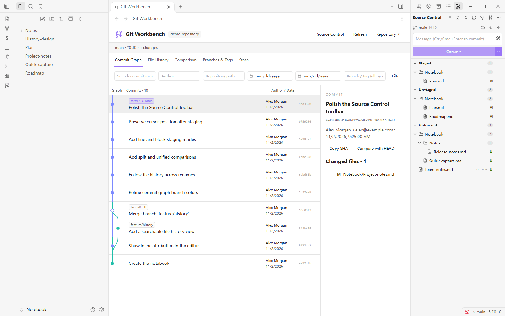
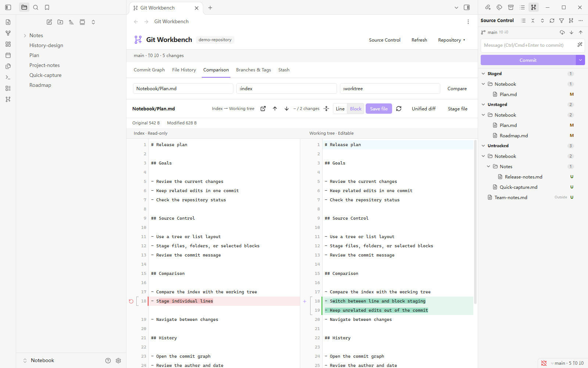
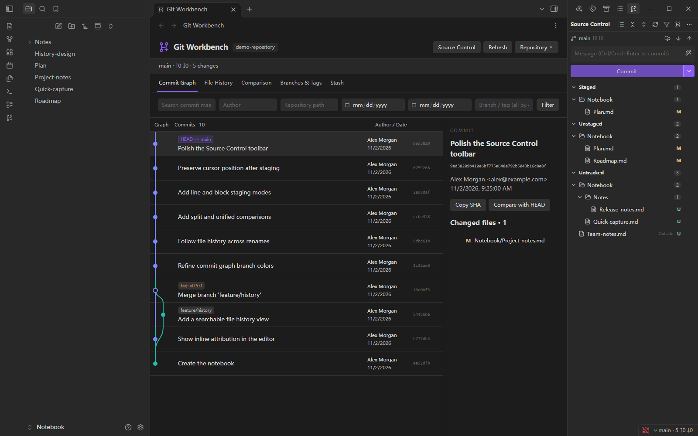
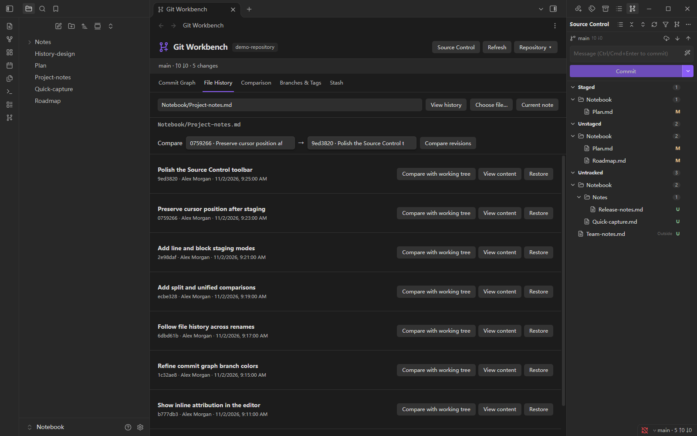
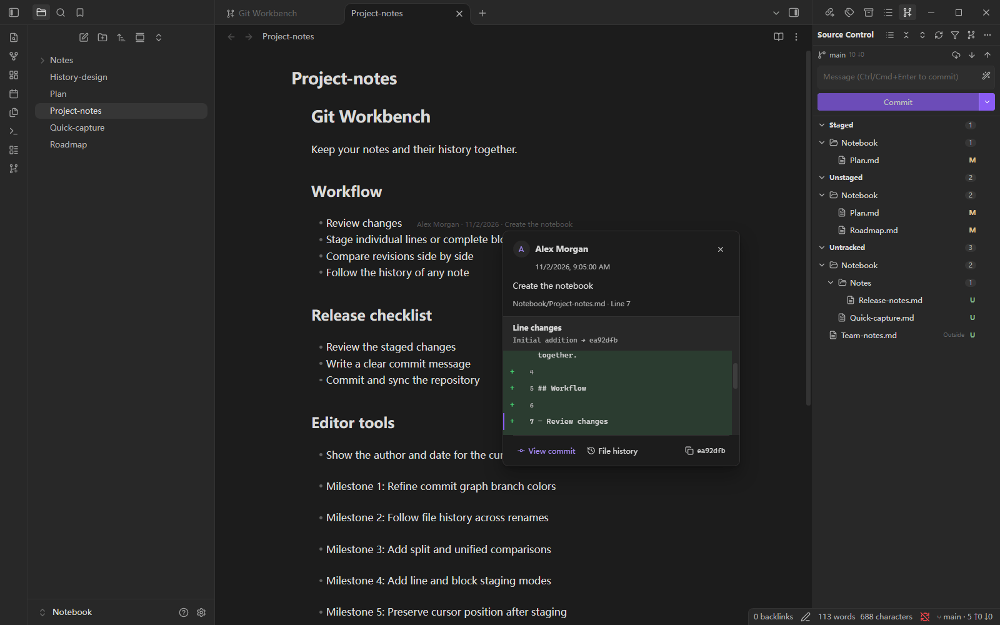

# Git Workbench

[简体中文](README.md) | **English**

Git Workbench is a Git workbench for Obsidian desktop. It brings commit history, source control, version comparison, file history, and line attribution into Obsidian so you can manage a notes repository from one workspace.

[Download and install](https://github.com/tongzhiquan/obsidian-git-workbench/releases) · [Report an issue](https://github.com/tongzhiquan/obsidian-git-workbench/issues) · [Changelog](CHANGELOG.md)

## Requirements

- Obsidian 1.14.4 or later on desktop.
- Git 2.30 or later available as `git` in your system terminal.
- Windows, macOS, or Linux desktop.
- Configure your Git identity before creating the first commit:

```bash
git config --global user.name "Your Name"
git config --global user.email "you@example.com"
```

## Installation

1. Download the latest ZIP from [Releases](https://github.com/tongzhiquan/obsidian-git-workbench/releases).
2. Put the `git-workbench` folder from the ZIP into your vault's `.obsidian/plugins/` directory.
3. Enable Git Workbench in Obsidian under Settings → Community plugins.
4. Open a Git-managed vault. If the vault is not a repository yet, initialize it from Repository operations.

To upgrade, replace the plugin files. Existing `data.json` and plugin settings are preserved.

## Interface Language

Choose **语言 / Language** at the top of the Git Workbench settings:

- **Follow Obsidian** (default): Chinese and its variants use Simplified Chinese; other languages use English.
- **简体中文**: always use Simplified Chinese.
- **English**: always use English.

Save unsaved comparison edits, then reload the plugin or restart Obsidian to apply the change. The current session keeps its original language. Switching language does not translate notes, existing commit messages, or custom templates. AI commit message output follows the prompt independently of the interface language.

## Source Control

When enabled, the plugin opens Source Control in the right sidebar. Changes are grouped as:

- Conflicts
- Staged
- Unstaged
- Untracked

Use tree or list layout. The `+` and `−` controls beside files, folders, and status groups stage or unstage changes. A file shown in both Staged and Unstaged contains partially staged changes.

The filter button limits the view to the current vault. When the vault is inside a parent repository, files outside the vault can also be inspected or operated on. Such files are marked as outside the vault, and filtered bulk actions only affect the current vault.



_Source Control groups changes by status and folder, with direct staging, unstaging, and commit actions._

Enter a commit message and click Commit. A commit includes staged content only. The panel also provides:

- Fetch, fast-forward-only Pull, and Push.
- Backup message templates and Amend.
- AI-generated commit messages.
- Context actions to open a file in Obsidian or reveal it in the system file manager.

## Version Comparison

The comparison view supports split and unified diffs for:

- The index versus the working tree.
- HEAD versus the index.
- Any two commits, branches, or tags.
- An empty version and a working file, useful before the first commit.

Version inputs accept branches, tags, commit SHAs, `HEAD`, and these special values:

| Input       | Meaning                  |
| ----------- | ------------------------ |
| `:index`    | The staged snapshot      |
| `:worktree` | The current working file |
| `:empty`    | An empty version         |

The toolbar includes Open file, Previous change, Next change, collapse unchanged regions, and Refresh. Previous and Next start from the current cursor on the most recently active side and keep focus there.



_Compare the index and working tree side by side, with line and block staging._

### Line and block staging

Switch the comparison between line staging and block staging. The choice is saved in settings.

- **Line mode** stages, unstages, or restores individual line changes. Drag selection and Shift-click line selection are also supported.
- **Block mode** operates on contiguous change blocks and shows each block's range.
- New files, deleted files, and multiple independent changes in one file support partial staging.
- Successful operations refresh the comparison in place while preserving the cursor, scroll position, and folding state when possible.

Restore changes only the working file. Stage and Unstage change only the index.

### Editing in the comparison view

Working-tree files can be edited and saved directly. The index is read-only by default and can be made editable in settings.

- Save working file does not stage the file automatically.
- Save staged file does not change the working tree.
- `Ctrl/Cmd + S` saves the currently editable side.
- A deleted working file can be recreated from the comparison view.
- Unsaved comparison content exists only for the current plugin session; save it before reloading or exiting.

## Commit Graph and File History

### Commit graph

The graph shows branch lines, merges, HEAD, and tags. Filter commits by message, author, date, path, branch, or tag, then open changed files and version actions from commit details.



_Inspect branch lines, tags, HEAD, commit details, and changed files._

### File history

Search file history by name and follow renames. From a historical version you can:

- View the historical text.
- Compare it with another version or the working tree.
- Restore the version.
- Create a branch or tag from the commit.
- Copy the full commit SHA.



_Search files, follow renames, and compare or restore historical versions._

## Line Attribution and Editor Markers

- Show the author, date, and commit summary for the current line.
- Hover line attribution to inspect the related commit and line diff.
- Enable attribution for the entire document.
- New, untracked, and uncommitted content is marked as uncommitted changes.
- Gutter markers show additions, modifications, and deletions relative to the index.
- Native undo/redo, continuous typing, and CRLF files keep markers synchronized.



_Hover line attribution to see the author, date, commit summary, and the exact line diff._

## Branches, Tags, Stash, and Conflicts

The workbench supports:

- Create, switch, and delete local branches.
- Create and delete tags.
- Merge, regular Rebase, Cherry-pick, and Revert.
- Save, inspect, Apply, Pop, and Drop Stash entries, including untracked files.
- Resolve conflicts by keeping either side or both sides by block, edit the result, then continue or abort the operation.

Deleted files, binary files, and files larger than 2 MiB use file-level conflict handling. This also applies when both side versions fit within the limit but the merged working file exceeds it. Saving checks complete and leftover conflict markers, respects `conflict-marker-size` in `.gitattributes`, and reports the remaining marker line numbers.

## AI Commit Messages

Enter the model and your DeepSeek API key under DeepSeek Commit Messages in settings. The plugin connects only to the official DeepSeek endpoint and defaults to `deepseek-flash`; see the [DeepSeek API documentation](https://api-docs.deepseek.com/). The AI button in Source Control reads the current staged diff and fills the commit message field; review or edit it before clicking Commit.

- Only the staged diff is sent by default; unstaged working-tree content is excluded.
- API keys are stored with Obsidian SecretStorage.
- The prompt, model, and maximum diff size are configurable.
- Generated text is never committed automatically.

## Automatic Backup

Automatic backup is disabled by default. When enabled, configure scheduled commits, pull on startup, and automatic sync. Automatic sync saves notes, stages changes, commits, fetches, fast-forward pulls, and pushes in that order.

Automatic tasks pause after conflicts, divergence, authentication failures, or network errors. Resolve the issue and resume them from settings.

## Command Palette

Available commands include:

- Open Git Workbench and Source Control.
- View history and diffs for the current note.
- Commit staged changes.
- Fill the current-time backup message manually and generate commit messages with DeepSeek.
- Fetch, Pull, and Push.
- Refresh the repository and toggle full-document attribution.

## Boundaries

- The plugin manages one Git repository and does not recursively manage submodules.
- There is no interactive Rebase, Reset, or force-push UI.
- Binary files and text files larger than 2 MiB show metadata instead of expanded text diffs.
- Text editing requires ordinary UTF-8 files. Mixed line endings, symlinks, and unsupported files remain read-only.
- Remote authentication uses the system SSH agent or credential helper. The plugin does not store passwords or tokens.

## License

This project is licensed under the [MIT License](LICENSE). Third-party licenses are included in release ZIP files.
