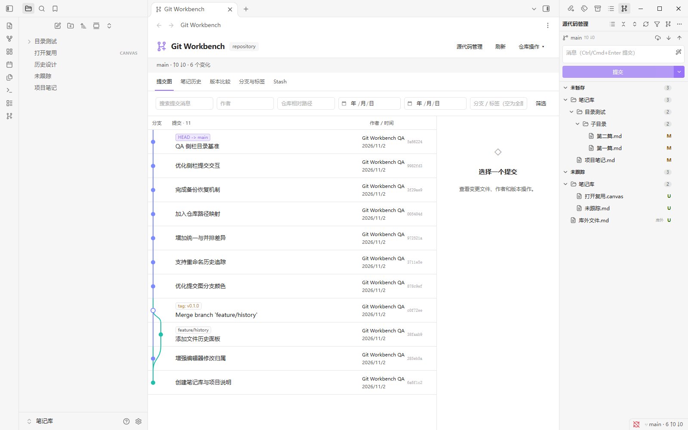
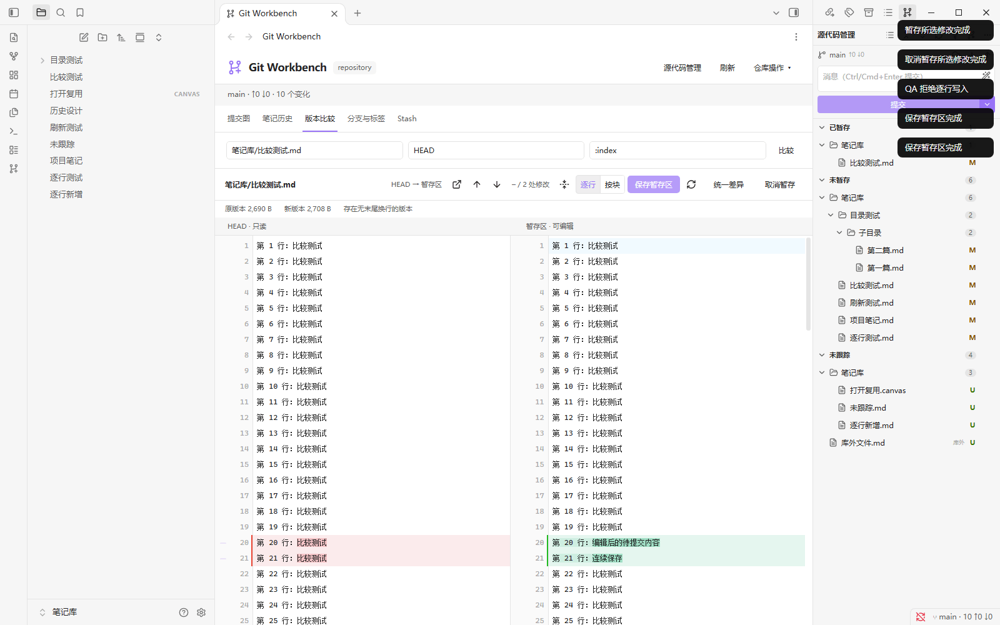
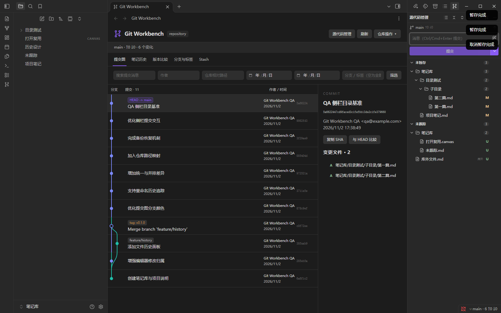
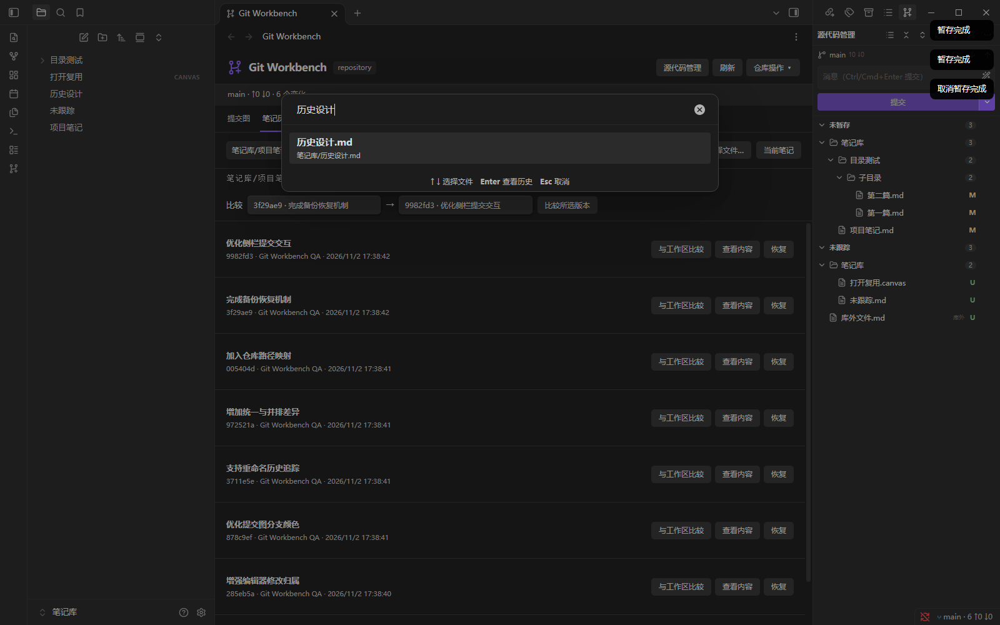
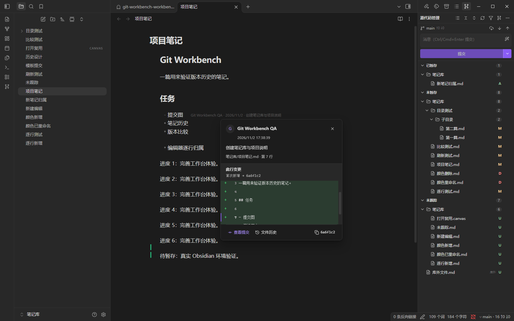

# Git Workbench

**简体中文** | [English](README.en.md)

Git Workbench 是面向 Obsidian 桌面端的 Git 工作台。它把提交图、源代码管理、版本比较、文件历史和行归属放在 Obsidian 内，让笔记仓库的日常 Git 操作可以在一个界面完成。

[下载与安装](https://github.com/tongzhiquan/obsidian-git-workbench/releases) · [问题反馈](https://github.com/tongzhiquan/obsidian-git-workbench/issues) · [更新日志](CHANGELOG.md)

## 适用环境

- Obsidian 1.14.4 或以上的桌面版。
- Git 2.30 或以上，并且可以在系统终端运行 `git`。
- Windows、macOS 和 Linux 桌面系统。
- 首次提交前，需要配置 Git 用户名和邮箱：

  ```bash
  git config --global user.name "Your Name"
  git config --global user.email "you@example.com"
  ```

## 安装

1. 从 [Releases](https://github.com/tongzhiquan/obsidian-git-workbench/releases) 下载最新 ZIP。
2. 将 ZIP 中的 `git-workbench` 文件夹放入笔记库的 `.obsidian/plugins/` 目录。
3. 在 Obsidian 的“设置 → 第三方插件”中启用 Git Workbench。
4. 打开一个已经由 Git 管理的笔记库；如果还没有仓库，可以在“仓库操作”中初始化。

升级时替换插件文件即可，已有的 `data.json` 和插件设置会保留。

## 界面语言

在 Git Workbench 插件设置顶部的“语言 / Language”中选择：

- **跟随 Obsidian**（默认）：中文及其变体使用简体中文，其他语言使用英文。
- **简体中文**：固定使用中文。
- **English**：固定使用英文。

修改后先保存比较器中未保存的编辑，再手动重载插件或重启 Obsidian。当前会话继续使用原语言。语言切换不会翻译笔记、已有提交消息或自定义模板；AI 提交消息的输出语言由提示词决定。

## 源代码管理

插件启用后会在右侧打开源代码管理面板。变化按以下状态分组：

- 冲突
- 已暂存
- 未暂存
- 未跟踪

支持目录树和列表两种布局。文件、文件夹和状态分组旁的 `+` / `−` 可以暂存或取消暂存；同一文件同时出现在“已暂存”和“未暂存”中，表示它包含部分暂存的修改。

漏斗按钮可以只显示当前笔记库的变化。仓库位于笔记库的上级目录时，也可以查看或操作仓库中的库外文件。库外文件会标出“库外”，过滤后批量操作只作用于当前笔记库。



_源代码管理：按状态和目录查看变化，直接暂存、取消暂存并提交。_

输入提交消息后点击“提交”。提交只包含已暂存内容。面板还提供：

- Fetch、仅快进 Pull、Push。
- 备份消息模板和 Amend。
- 通过 AI 生成提交消息。
- 文件右键菜单中的“在 Obsidian 中打开”和“在系统资源管理器中显示”。

## 版本比较

比较区支持并排差异和统一差异，可比较：

- 暂存区与工作区。
- HEAD 与暂存区。
- 任意两个提交、分支或标签。
- 空版本与工作文件，适用于首次提交前的新文件。

版本输入支持分支、标签、提交 SHA、`HEAD`，以及：

| 输入        | 含义         |
| ----------- | ------------ |
| `:index`    | 暂存区快照   |
| `:worktree` | 当前工作文件 |
| `:empty`    | 空版本       |

比较工具栏提供打开文件、上一处修改、下一处修改、折叠未修改区域和刷新。上一处/下一处修改从当前光标所在的一侧开始查找，并保留当前焦点。



_版本比较：并排查看 HEAD、暂存区和工作区内容，并处理部分修改。_

### 逐行暂存与按块暂存

比较区可以在“逐行”和“按块”两种暂存模式之间切换，选择会保存到设置中。

- **逐行模式**：暂存、取消暂存或还原单行修改，也可以拖选或使用 Shift 连续选择多行。
- **按块模式**：按照连续修改块操作。每个块会显示首尾范围，适合一次处理一组相邻修改。
- 新增文件、删除文件以及同一文件中的多个独立修改都支持部分暂存。
- 操作成功后比较区原地刷新，尽量保留光标、滚动位置和折叠状态。

“还原”只修改工作文件；“暂存”和“取消暂存”只修改暂存区。

### 比较区编辑

工作区文件可以直接编辑并保存。暂存区默认只读，也可以在设置中开启“允许编辑暂存区”。

- “保存工作文件”不会自动暂存。
- “保存暂存区”不会修改工作文件。
- `Ctrl/Cmd + S` 保存当前可编辑的一侧。
- 已删除的工作文件可以通过“重新创建文件”恢复。
- 未保存内容只保留在当前插件会话中，退出或重载前请先保存。

## 提交图与文件历史

### 提交图

提交图显示分支连线、合并、HEAD 和标签。可以按提交消息、作者、日期、路径、分支或标签筛选，并从提交详情进入文件差异和版本操作。



_提交图：查看分支连线、标签、HEAD、提交详情和变更文件。_

### 文件历史

文件历史支持按名称搜索，并跟踪文件重命名。选择历史版本后可以：

- 查看历史文本。
- 与另一个版本或工作区比较。
- 恢复历史版本。
- 从提交创建分支或标签。
- 复制完整提交 SHA。



_文件历史：搜索文件、追踪重命名，并比较或恢复历史版本。_

## 行归属与编辑器标记

- 当前行可以显示作者、日期和提交摘要。
- 悬停行归属可以查看对应提交和行差异。
- 可以开启整篇逐行归属。
- 新增、未跟踪和未提交内容显示“未提交的修改”。
- 行号旁的变化标记显示相对暂存区的新增、修改和删除。
- 原生撤销/重做、连续输入和 CRLF 文件会同步更新标记。



_将鼠标移到行归属信息上，可以查看作者、日期、提交摘要和该行的具体差异。_

## 分支、标签、Stash 与冲突

工作台提供以下仓库操作：

- 创建、切换和删除本地分支。
- 创建和删除标签。
- Merge、普通 Rebase、Cherry-pick 和 Revert。
- 保存、查看、应用、Pop 和删除 Stash，支持包含未跟踪文件。
- 冲突视图中按块保留当前侧、对方侧或双方内容，编辑结果后继续或中止操作。

删除文件、二进制文件和超过 2 MiB 的文件冲突按文件处理。

## AI 提交消息

在设置中选择 OpenAI、DeepSeek 或自定义 OpenAI 兼容接口，填写模型和 API Key。源代码管理面板中的 AI 按钮会读取当前暂存区 diff，并将生成的提交消息填入输入框；检查或修改后仍需手动点击“提交”。

- 默认只发送暂存区 diff，不发送未暂存工作区内容。
- API Key 使用 Obsidian SecretStorage 保存。
- 提示词、模型和最大 diff 字符数可配置。
- 生成结果不会自动提交。

## 自动备份

自动备份默认关闭。开启后，可以配置定时提交、启动拉取和自动同步。自动同步的顺序是保存笔记、暂存变化、提交、Fetch、仅快进 Pull、Push。

发生冲突、分叉、认证或网络错误时，自动任务会暂停，并在设置中提供恢复入口。

## 快捷入口

插件命令面板提供常用操作，包括：

- 打开 Git 工作台和源代码管理。
- 查看当前笔记历史和差异。
- 暂存或取消暂存当前笔记。
- 提交已暂存变化。
- Fetch、Pull、Push 和同步。
- 刷新仓库、切换整篇逐行归属。
- 创建分支、创建标签和管理 Stash。

## 功能边界

- 插件管理一个 Git 仓库，不递归管理子模块。
- 不提供交互式 Rebase、Reset 或强制推送界面。
- 二进制文件和超过 2 MiB 的文本文件只显示元信息，不展开文本差异。
- 文本编辑要求普通 UTF-8 文件；混合换行、符号链接和不适合直接编辑的文件会保持只读。
- 远程认证使用系统 SSH agent 或 credential helper，插件不保存密码或 Token。

## 许可证

本项目采用 [MIT 许可证](LICENSE)。第三方依赖许可随发布 ZIP 一起提供。
